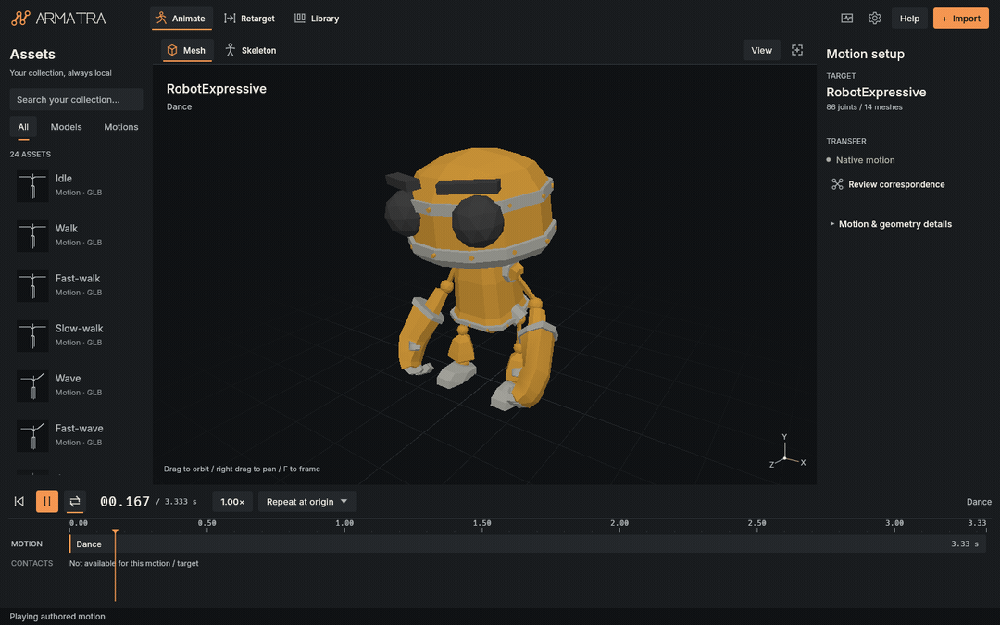
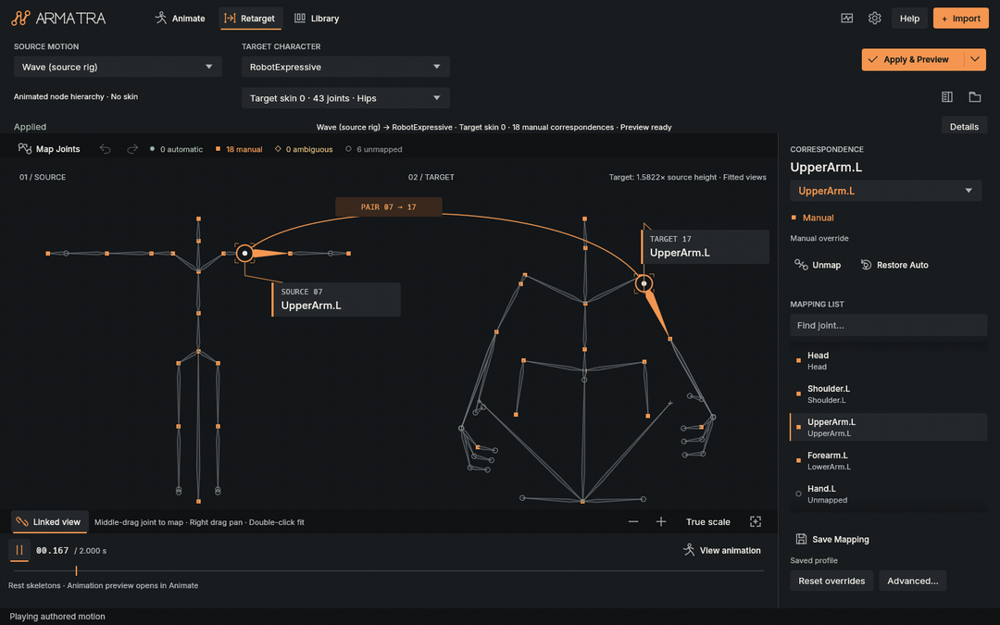
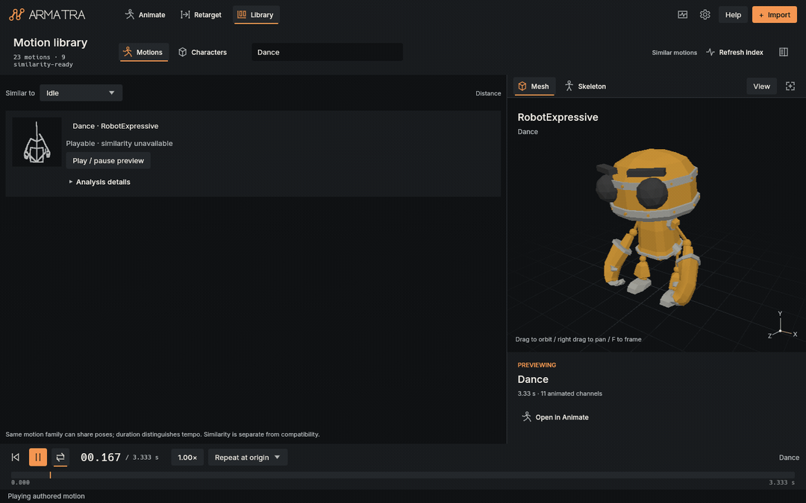
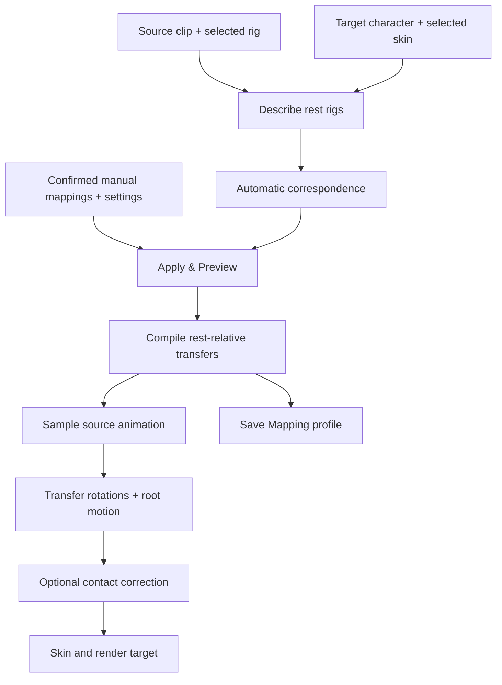

# Armatra

**A native skeletal animation viewer with retargeting and a local Motion Library.**

[](https://github.com/Speed126/Armatra/actions/workflows/ci.yml)

[](LICENSE)



Armatra loads characters and motion clips, plays their animation, and transfers
motion between different skeletons. Use it to inspect imported animation, correct
joint correspondence, and try motion on another character without setting up a
full scene in a modelling package. Assets and saved mappings stay local.

## How to Use

### Download and launch

For a prebuilt Windows x64 package, see the
[Releases page](https://github.com/Speed126/Armatra/releases). Extract the whole
ZIP into a folder and run `armatra.exe`. Keep its demo and license files together.
The portable application does not require Rust or Python.

From the extracted folder, in PowerShell:

```powershell
.\armatra.exe
.\armatra.exe assets/demo/RobotExpressive.glb
```

The included [RobotExpressive](assets/README.md) has several skeletal clips.
Its unsupported facial morph animation has been removed. Nine bundled
motion-only samples appear in the Library automatically on first launch.

### Build from source

Requires **Rust 1.99.1**, installed through rustup, and the Windows MSVC C++
build tools with a Windows SDK. The toolchain and dependencies are pinned.
A compatible graphics adapter and driver are required to open the application.

From the source repository root:

```powershell
cargo build --locked --release
.\target\release\armatra.exe assets/demo/RobotExpressive.glb
```

For a development build:

```powershell
cargo run --locked -- assets/demo/RobotExpressive.glb
```

Multiple input paths can be supplied. Paths are relative to the working
directory. Windows x64 is verified for this release; other desktop platforms
have not been verified for this snapshot.

### Import and inspect motion

1. Click **Import asset**, use **Ctrl+O**, or drop supported files onto the
   window. Import a rigged character and a motion, or a file containing both.
2. In **Animate**, choose the character and motion in the asset browser.
   One file can produce a character entry and several separate clip entries.
3. Press **Space** or click **Play**. Click or drag the timeline to seek;
   **Home** returns to the beginning. The transport provides speed and loop controls.
4. Drag the viewport to orbit, right-drag to pan, scroll to zoom, and press
   **F** to frame the character. Mesh, skeleton, and bind-pose controls help
   distinguish the imported rest rig from its animated pose.

### Browse the Motion Library

Open **Library** and select a clip row to inspect its details and representative
poses. Selection alone does not replace the playing motion. Click **Preview**
or a pose image to activate the clip at that time.

Try several entries in sequence. A motion without a compatible target can be
shown on its original source rig. Motion-only files can display a skeleton
rather than a character mesh. Import more GLB, local glTF, or BVH files with
the same import command.

### Transfer motion to another character

Retargeting applies motion recorded on one skeleton to another skeleton.
Joint names and proportions can differ, but their roles and rest orientations
must be understandable.

1. Open **Retarget**. Choose **SOURCE MOTION** and **TARGET CHARACTER**.
2. Check the skin selector below each asset. A skin identifies the joint
   palette that deforms a mesh. For multiple-skin files, choose the palette
   belonging to the character you intend to animate.
3. Inspect the proposed links. Select a joint or mapping row to highlight both
   ends. Ambiguous and unmatched rows need attention.
4. Click **Map Joints** or press **M**, choose a source and target joint, and
   confirm the pair. Middle-dragging source to target, or **Shift+left-drag**,
   opens the same confirmation. Search helps with dense rigs.
5. Click **Apply & Preview**. Armatra compiles the current skins, settings, and
   confirmed edits, then opens the animated target in **Animate** from the
   beginning. Confirmed edits remain pending until applied. The adjacent menu's
   **Apply Only** compiles without switching workspaces.
6. Return to Retarget and use **Save Mapping** to keep the profile. Selecting
   the same asset pair later, including after restarting, restores a compatible
   saved profile. Skin choices and manual overrides are saved with it.

A failed apply reports the problem without replacing a valid active preview.
If orientation cannot be inferred, use **Advanced retarget settings** to
supply the source-to-target frame alignment before applying.

## What It Does

| Area | Function |
|---|---|
| Animate | Character playback, timeline seeking, signed speed, looping, mesh and skeleton inspection |
| Retarget | Automatic correspondence, confirmed manual overrides, skin selection, root-motion settings, optional contact correction |
| Library | Local import, clip browsing, search, representative poses, and motion similarity ranking |
| Imports | GLB 2.0, local glTF 2.0 with relative resources, and BVH skeletal motion |
| Rendering | GPU skinning, textured meshes, depth testing, transparency, skeleton overlays, and a scale-aware grid |
| Persistence | Managed asset copies, mapping profiles, library generations, session and interface preferences |

### Retargeted motion

A saved manual mapping transfers the bundled Wave motion from its source
skeleton to RobotExpressive. The clip shows the correspondence and resulting
target playback; unmapped joints retain their rest pose.



### Motion Library previews

Dance, Running, and Wave previewed in the Library.



## Useful Controls

| Control | Action |
|---|---|
| `Ctrl+O` | Import an asset |
| `Space` / `Home` | Play or pause / return to the start |
| Click or drag timeline | Seek to a time |
| Left-drag viewport background | Orbit |
| Right-drag | Pan |
| Scroll / `F` | Zoom / frame the character |
| Click joint or mapping row | Select the joint pair in Retarget |
| `M` | Start Map Joints |
| Middle-drag source → target; `Shift+left-drag` | Propose a correspondence |
| `Enter` in the focused confirmation panel / `Escape` | Confirm / cancel a proposal |
| `Ctrl+Z` / `Ctrl+Y` or `Ctrl+Shift+Z` | Undo / redo a mapping edit |
| Up / Down in a focused mapping list | Move between rows |

In the Retarget canvas, middle-dragging empty space pans and double-clicking
fits one skeleton. Camera linking can keep the two rig views aligned.
Shortcuts yield to text and number fields; confirmation keys apply to the
focused correspondence panel.

## How Retargeting Works

[`rig.rs`](src/rig.rs) identifies the selected skin's joints and describes their
names, anatomical roles, sides, rest positions, directions, lengths, and hierarchy.
For motion without a skin, it follows the connected hierarchies of animated
nodes and retains unanimated rig anchors. Pelvis, head, and bilateral anchors
provide a character frame when they can be identified.

[`assignment.rs`](src/assignment.rs) scores candidate pairs using those
descriptors. A global one-to-one assignment chooses target joints while allowing
a source joint to remain unmatched. Confidence reflects semantic and geometric
information and the cost of an alternative assignment; it is not a probability.

Manual mappings constrain that assignment. An override can pair a source joint
with a target or explicitly leave it unmapped. Conflicts require confirmation,
and edits can be undone. Skin selection matters because vertex weights refer
to that skin's joint palette. Mapping an unweighted end joint can move the
skeleton without visibly moving the mesh.



Apply snapshots the assets, clip, skins, settings, and overrides. Compilation
runs in the background; a changed selection invalidates stale results. The target
starts from its own rest pose. Source rotation changes, including unmapped
ancestors, are aligned into target joint frames. Root translation can scale by
the height ratio, remain unscaled, or be suppressed for in-place motion.
Supported twist chains distribute rotation across target subdivisions. Optional
contact analysis and leg IK reduce foot movement during detected stance intervals.

A profile contains asset signatures, algorithm version, settings, skins,
overrides, correspondence rows, and compiled transfer data. Profiles use
checksummed immutable generations and are validated before restoration.

## Playback and Rendering

Rust owns the animation and asset pipeline. **winit** supplies the native window
and events, **egui** draws the interface, and **wgpu** renders and composes the viewport.

Sampling supports translation, rotation, and scale tracks with glTF STEP,
LINEAR, and CUBICSPLINE interpolation. Linear rotations use quaternion slerp;
cubic quaternion results are normalized. Forward playback reuses track cursors,
while discontinuous seeking finds the interval again. Local poses are composed
through the scene hierarchy before skin matrices are built.

The vertex shader uses linear blend skinning, with optional dual quaternion
skinning for rigid palettes. Affine or nonuniform palettes use the matrix path.
Rendering includes base-color textures, directional diffuse lighting, alpha
masking/blending, and depth testing. It is an inspection renderer with a
perspective orbit camera, rather than a complete glTF PBR implementation.
The grid follows imported rest geometry instead of changing with each pose.

## Motion Library

Imports are normalized to self-contained GLB data and copied into a
content-addressed managed library. Local glTF buffers and PNG/JPEG images are
resolved at import; BVH becomes a skeleton and clip. Moving the originals after
a completed import does not break the managed copy. Deleted bundled entries
are not automatically restored on the next launch.

The Windows default is `%LOCALAPPDATA%\Armatra\library`. It contains asset blobs,
manifest generations, thumbnails, profiles, and session settings.
`ARMATRA_LIBRARY` selects another folder:

```powershell
$env:ARMATRA_LIBRARY = Join-Path $env:LOCALAPPDATA 'Armatra\demo-library'
.\target\release\armatra.exe assets/demo/RobotExpressive.glb
```

Only one process can write a given library at a time. Back up the whole folder
to preserve imports and mappings.

A row click changes browser selection. **Preview** activates the clip, validates
its pose and GPU resources, and reconciles its rig with the current target.
Loading is asynchronous; generation checks prevent an older request from
replacing a later selection. Failed activation reports an error and preserves
the current valid state.

Similarity ranking is experimental and needs recognized humanoid anchors. A
playable clip can still show **similarity unavailable**; similarity distance
does not establish retarget compatibility.

## Tests and Codebase

Run from the source root:

```powershell
cargo fmt --check
cargo clippy --locked --all-targets -- -D warnings
cargo test --locked --all-targets
cargo build --locked --release
```

Tests cover import validation, sampling, skinning math, assignment, retarget
transforms, profile persistence, library recovery, and interface state.
Procedural fixtures use MIT. The optional external Fox interoperability fixture
can be fetched with `python scripts/fetch-test-fixture.py`; it is not distributed.

With a working graphics adapter:

```powershell
.\target\release\armatra.exe --gpu-smoke
.\target\release\armatra.exe --ui-smoke
.\scripts\smoke-mapping.ps1
.\scripts\smoke-apply.ps1
.\scripts\smoke-library.ps1
```

The native scripts drive egui pointer/key events through the application and
read back actual GPU frames. They cover mapping confirmation, skin selection,
apply/save/restart, and repeated Library activation. They do not test a physical
mouse, OS focus, or file-dialog interaction. Outputs go to ignored directories.

The [workflow](.github/workflows/ci.yml) is configured to format, lint, test,
build, and package on Windows. Graphics checks require a desktop adapter and
run separately; a hosted CI pass does not establish graphics compatibility.

Build a portable ZIP with Python 3.11+ and Cargo available:

```powershell
python scripts/package.py
python -m unittest discover -s tests -p "test_*.py"
```

The packager builds the locked release, includes the demo and required notices,
and writes a ZIP and SHA-256 file to `dist`. It does not publish a release.

| Location | Responsibility |
|---|---|
| `src/app/`, `src/ui/` | Workspaces, input, jobs, mapping editor, timeline and widgets |
| `src/animation.rs`, `src/scene.rs`, `src/import/` | Sampling, scene data and format normalization |
| `src/rig.rs`, `src/assignment.rs`, `src/retarget.rs` | Rig descriptors, correspondence and motion transfer |
| `src/contacts.rs`, `src/ik.rs` | Contact detection and pose correction |
| `src/render.rs`, `src/skinning.rs`, `shaders/` | Camera, GPU resources, skinning and drawing |
| `src/library.rs`, `src/profile.rs`, `src/session.rs` | Storage, profiles and preferences |
| `src/motion_search/`, `src/compression.rs`, `src/cache*.rs` | Motion descriptors, bounded caches and animation data utilities |
| `tests/`, `assets/`, `scripts/` | Regressions/fixtures, licensed demo/fonts, packaging and native checks |

## Limitations

- Windows x64 is verified. Linux and macOS runtime behavior is unverified for
  this snapshot. A compatible D3D12, Vulkan, or Metal adapter is required;
  there is no CPU viewport fallback.
- FBX, OBJ, USD, and video import are unsupported. Local glTF resources must
  remain inside the asset directory; remote URLs and data URIs are rejected.
  Unsupported compression/extensions need conversion.
- Morph-target animation is unsupported. Clips using unsupported deformation
  are diagnosed. The full glTF material model, scene lights, shadows, and facial
  animation are not reproduced.
- Retargeting requires identifiable rigs, a usable character frame, and rigid
  rest transforms with positive uniform scale. Reflected, sheared, and nonuniform
  rig transforms are rejected. Automatic correspondence is limited to 1,024
  joints per selected rig and needs inspection on unfamiliar rigs.
- An automatic proposal can be rejected when parent/chain assignments conflict.
  Correct the correspondence before applying; a similar name does not establish
  a compatible hierarchy.
- Contact correction is heuristic. Different proportions, rest poses, and
  ambiguous anatomy can need manual mapping and alignment. Saving a profile
  does not export a retargeted GLB, FBX, or BVH.
- Import budgets include a 128 MiB normalized file limit, 32,768 nodes,
  4,096-pixel image sides, and 256 MiB of decoded data. Device limits can be lower.

## License

Project code and procedural assets are [MIT licensed](LICENSE).
[Third-party notices](THIRD_PARTY_LICENSES.md) cover dependencies and fonts.
[Demo provenance](assets/README.md) credits RobotExpressive under CC0 1.0 and
the Inter-derived fonts under SIL OFL 1.1.
